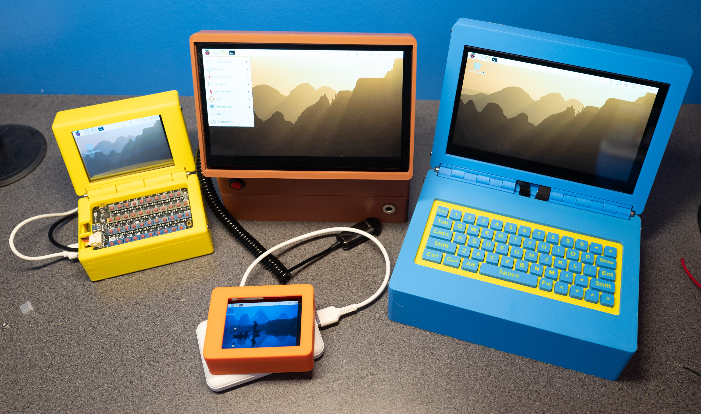

# Raspberry-pi-cyberdeck
Designs and construction details for cyberdecks powered by Raspberry Pi computers

Above you can see the cyberdecks that the author has come up with so far. In the centre  you can see the Tiny Orange Tablet - Raspberry Pi Zero powered with a 2.8 inch LCD panel, on the left Little Yellow - also powered by a Raspberry Pi Zero with a 3.2 inch screen, in the middle Bourbon Classic Camera – powered by a Raspberry Pi 4 which has a tiltable screen so that it can be used as camera viewfinder and the Blue Camshell, which is a laptop design powered by a Raspberry Pi 4 with a custom designed clicky keyboard. Here are the build instructions parts lists for each. (You don't have to use the same colours I have)

## Buying parts

You can find all the parts used here in this [Amazon List](https://www.amazon.co.uk/hz/wishlist/ls/1ZTVXPLOWJS1?ref_=wl_share). I've also added links to manufacturers sites where I can. 

## Tiny Orange Tablet - Raspberry Pi Zero

Perhaps the smallest tablet you can make. Needs an external power supply. The screen is capacitive and very bright. 

* **Screen** [2.8 inch LCD panel from Waveshare](https://www.waveshare.com/2.8inch-DPI-LCD.htm). 

* **Power** external battery that you plug into the device. 

* **Print files** [here](/3d%20print/Tiny%20Tablet/).

Print the files and use M2 Phillips Pan Head Screws with 6mm Round Heads to screw the Raspberry Pi Zero to the back of the case. Then push the display onto the Pi Zero and fit the top. 

## Little Yellow - Raspberry Pi Zero 

A tiny cyberdeck with a folding action and a credit card sized keyboard. Powered by an internal battery pack. You will need to make up a cable to power the keyboard. 

* **Screen**  [3.5 inch LCD Panel from Elegoo](https://www.elegoo.com/en-gb/blogs/arduino-projects/elegoo-3-5-inch-touch-screen-for-raspberry-pi-manual).

* **keyboard** [M5Stack KB2 credit card size](https://docs.m5stack.com/en/unit/Unit_CardKB2)

* **Power** internal battery: Miady Ultra Slim Portable Charger Power Bank 5000mAh 3.67*2.4*0.55 inch in the base of the unit. 

* **Print files** [here](/3d%20print/Little%20Yellow/).

Print the files, making sure to print the top of the base face down with support for the keyboard recess. Use long M3 bolts into the each end of the hinge. Use M2 Phillips Pan Head Screws with 6mm Round Heads to screw the Raspberry Pi Zero to the back of the screen. Then push the display onto the Pi Zero and fit the top to the display. Put the battery into the base and run a cable between the battery output and the power input of the Pi. Then take a cable out of the usb socket on the Pi and use this output to power the keyboard. The keyboard is configured as Bluetooth and connected to the Pi. 

## Bourbon Classic Camera - Raspberry Pi 4

A reversed flip-up display which can be used as a large viewfinder for the built-in camera. Powered by a UPS module containing 18650 batteries (be sure to buy this as well as the module)

* **Screen**  [ELECROW 7" 1024x600 Touchscreen Monitor ](https://www.elecrow.com/7inch-ips-hd-touch-screen-d-1024-600-hd-monitor-compatible-with-raspberry-pi-bb-black-etc.html).

* **keyboard** You can use any external keyboard, plug the adapter into the Pi or connect via Bluetooth. 

* **Power** i15W 3A Battery Boost Charging 5v UPS,Tiny 5v UPS Module High Power UPS 18650

* **Print files** [here](/3d%20print/Bourbon%20Classic%20Camera/).

The outward facing hinges make these models harder to print. I printed them flat with internal support for the top of the cavity. Alternatively put them on one side and print with tree support. Use curly cables (in the Amazon list) to connect the screen HDMI and USB. Use very thick wire for the power cables onto the PI 40 pin connector. There is room in the base for different battery types. Hinges are fitted as for the Little Yellow cyberdeck. 

## Blue Clamshell - Raspbery Pi 4

A traditional clamshell with an internal battery pack. This version has fancy camera graphics (sort of a camshell - ho ho) on the top and the bottom. 

* **Screen**  [ELECROW 7" 1024x600 Touchscreen Monitor ](https://www.elecrow.com/7inch-ips-hd-touch-screen-d-1024-600-hd-monitor-compatible-with-raspberry-pi-bb-black-etc.html).

* **keyboard** Uses a custom keyboard you can find [here](https://github.com/CrazyRobMiles/PICO-Cyberdeck-keyboard). 

* **Power** i15W 3A Battery Boost Charging 5v UPS,Tiny 5v UPS Module High Power UPS 18650

* **Print files** [here](/3d%20print/Bourbon%20Classic%20Camera/).

Hinges will print without support. Load the image files along with their corresponding parts and then import them into the slicer as a single object. Then set filament colours to print the logo. You can use the flat HDMI and USB cables to connect the Pi and the display. 

Have Fun!

[Rob Miles](https://www.robmiles.com/)
